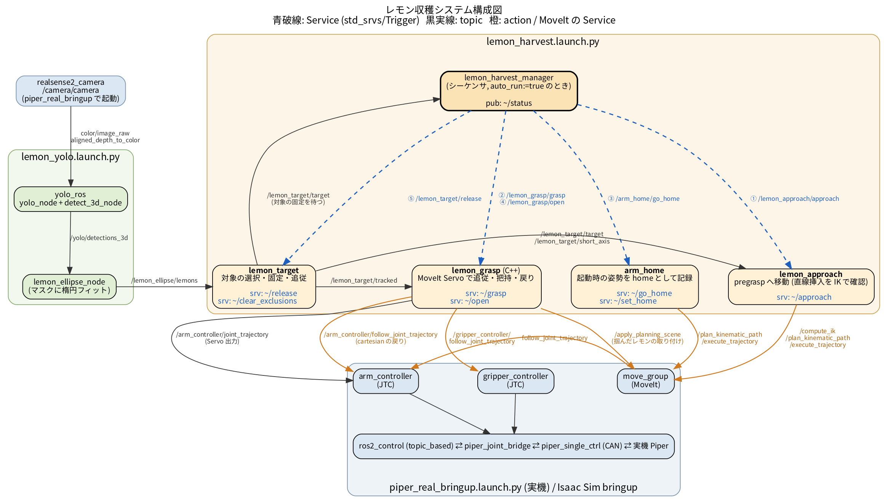
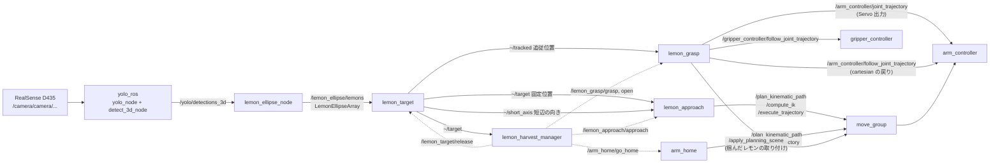
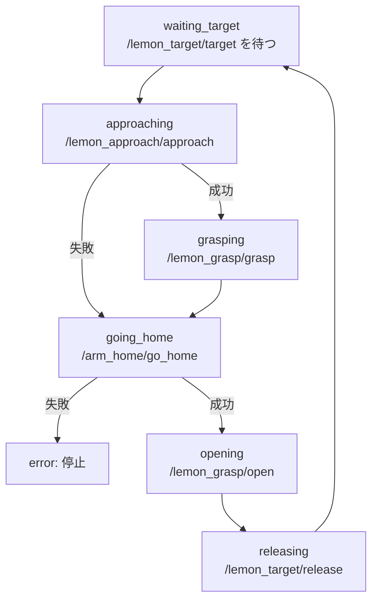

# レモン収穫システム構成 (`lemon_harvest.launch.py`)

`ros2 launch lemon_reach lemon_harvest.launch.py` で起動するノードと、
その前提となるノード (bringup / YOLO) の構成・データの流れ・シーケンスのまとめ。

## 1. 起動の全体像

収穫システムは 3 つの launch に分かれていて、上から順に起動する。

| 順 | launch | 役割 |
|---|---|---|
| 1 | `piper_real piper_real_bringup.launch.py` (実機) / Isaac Sim 側の bringup | アーム・ros2_control・MoveIt (move_group)・手首カメラ・TF |
| 2 | `lemon_reach lemon_yolo.launch.py` | YOLO によるレモン検出と3D化、楕円フィット (`/lemon_ellipse/lemons`) |
| 3 | `lemon_reach lemon_harvest.launch.py` | 対象選択 → 接近 → 把持 → 帰還 のシーケンス (**本書の対象**) |

```bash
# 実機の例
cd ~/piper_ros && bash can_activate.sh can0 1000000
ros2 launch piper_real piper_real_bringup.launch.py cam_x:=... cam_y:=... cam_z:=... cam_roll:=... cam_pitch:=... cam_yaw:=...
ros2 launch lemon_reach lemon_yolo.launch.py
ros2 launch lemon_reach lemon_harvest.launch.py            # sim:=true で Isaac Sim 用
```

`lemon_harvest.launch.py` は YOLO を含まない。`/lemon_ellipse/lemons` が来ないと
`lemon_target` が対象を選べず、シーケンスは `waiting_target` のまま止まる。

## 2. lemon_harvest.launch.py が起動するノード

| ノード名 | パッケージ / 実行ファイル | 役割 | 提供する Service |
|---|---|---|---|
| `lemon_target` | lemon_reach / `lemon_target_node` | 安定して見えるレモンを1つ選んで固定し、位置・短辺の向きを配信 | `~/release`, `~/clear_exclusions`, `~/select` |
| `lemon_approach` | lemon_reach / `lemon_approach_node` | 固定したレモンの手前 (pregrasp) へ MoveIt で移動 | `~/approach` |
| `lemon_grasp` | lemon_grasp / `lemon_grasp_node` (C++) | MoveIt Servo で追従しながら指先を差し込み、掴んで pregrasp へ戻る | `~/grasp`, `~/open`, `~/stop` |
| `arm_home` | lemon_reach / `arm_home_node` | 起動時の姿勢を home として記録し、そこへ戻す | `~/go_home`, `~/set_home` |
| `lemon_harvest_manager` | lemon_reach / `lemon_harvest_manager_node` | 上の Service を順に呼ぶシーケンサ (`auto_run:=false` で起動しない) | — |

## 3. データの流れ



図のソースは `lemon_harvest_system.dot` (Graphviz)。編集したら次で作り直す:

```bash
cd ~/lemon_ws/src/lemon_reach/docs
dot -Tpng -Gdpi=130 lemon_harvest_system.dot -o lemon_harvest_system.png
dot -Tsvg lemon_harvest_system.dot -o lemon_harvest_system.svg
```

<details>
<summary>Mermaid 版 (テキストで見る場合)</summary>



</details>

実線は topic / action、点線は manager からの Service 呼び出し (すべて `std_srvs/Trigger`)。

### 主な topic

| topic | 型 | 配信元 | 内容 |
|---|---|---|---|
| `/lemon_ellipse/lemons` | `lemon_msgs/LemonEllipseArray` | lemon_ellipse_node | 検出ごとの3D中心・短辺/長辺の向き (カメラ光学座標系、撮影時刻) |
| `/lemon_target/target` | `geometry_msgs/PointStamped` (latched) | lemon_target | 固定した対象の位置 (base_link)。`frame_id` が空なら「対象なし」 |
| `/lemon_target/tracked` | `geometry_msgs/PointStamped` (latched) | lemon_target | 固定中も検出で更新し続ける位置 (grasp はこちらへ向かう) |
| `/lemon_target/short_axis` | `geometry_msgs/Vector3Stamped` (latched) | lemon_target | 楕円の短辺 = グリッパで挟む向き (base_link)。ゼロなら不定 |
| `/lemon_harvest_manager/status` | `std_msgs/String` | manager | シーケンスの状態 |
| `/lemon_approach/status`, `/lemon_grasp/status` | `std_msgs/String` | 各ノード | 各ノードの状態 |

### 配信される TF

| frame | 配信元 | 内容 |
|---|---|---|
| `lemon_target` | lemon_target | 固定位置 (姿勢は単位) |
| `lemon_tracked` | lemon_target | 追従位置 |
| `lemon_pregrasp` | lemon_approach | pregrasp での指先の目標姿勢 |
| `lemon_grasp_frame` | lemon_approach | レモン位置に置いた、差し込むときの姿勢 |

## 4. シーケンス (lemon_harvest_manager)



- approach / grasp が失敗しても home へ戻り、グリッパは常に開く (閉じたままにしない)。
- release で、その位置は除外リストに入り再選択されない (掴めた・掴めなかったに関わらず)。
  除外を消すには `/lemon_target/clear_exclusions`。
- home へ戻れないときだけシーケンス全体を止める (home の視野で次の対象を選ぶため)。
- 各 Service 呼び出しのタイムアウトは `call_timeout` (120 s)。

`auto_run:=false` では manager を起動しないので、同じ順に手で呼んで1段ずつ確かめられる。

```bash
ros2 service call /lemon_approach/approach std_srvs/srv/Trigger
ros2 service call /lemon_grasp/grasp       std_srvs/srv/Trigger
ros2 service call /arm_home/go_home        std_srvs/srv/Trigger
ros2 service call /lemon_grasp/open        std_srvs/srv/Trigger
ros2 service call /lemon_target/release    std_srvs/srv/Trigger
```

## 5. 各ノードの詳細

### lemon_target (`lemon_reach/lemon_target_node.py`)

状態は2つ。

- **COLLECTING**: `window_sec` (3 s) の間、検出を `cluster_radius` (2 cm) でまとめ、
  フレームの `min_detection_ratio` 以上で同じ位置に見えたものを「安定」とする。
  安定したもののうち base_link から一番近いものを選んで LOCKED へ。
- **LOCKED**: `~/target` は固定位置のまま。近傍 (`track_radius` 4 cm 以内、固定位置から
  `max_track_offset` 10 cm 以内) の検出を `track_alpha` で平滑化して `~/tracked` を更新する。
  `~/release` で COLLECTING に戻る。

対象の選び方は `selection_mode` で切り替える。

- **auto** (既定): 上のとおり、安定したもののうち一番近いものを自動で選ぶ。
- **manual**: 自動では選ばない。`~/select` (`lemon_msgs/srv/SelectTarget`) で指定した位置に
  一番近い安定したレモンを固定する (UI で人が検出枠をクリックして選ぶため)。
  指定位置から `select_radius` (5 cm) より遠ければ断る。人が選ぶので除外リストでは外さない。
- `~/select` はどちらのモードでも使える。**固定中は断る** (把持中に対象が入れ替わると
  危ないため。先に `~/release`)。安定した候補が無いときは理由を返す
  (観測が 3 s 未満 / フレーム不足 / 映っている割合が `min_detection_ratio` 未満)。

```bash
ros2 service call /lemon_target/select lemon_msgs/srv/SelectTarget \
  "{point: {header: {frame_id: base_link}, point: {x: 0.36, y: 0.05, z: 0.03}}}"
```

その他のポイント:

- 検出は **撮影時刻の TF** で base_link に変換する (最新の TF だと YOLO の遅延分だけずれる)。
  TF が届くまで最大 `tf_timeout` (0.5 s) 保留する。
- カメラから `min_depth` (0.12 m) より近い検出は使わない (D435 の最短距離、グリッパの影)。
- 短辺の向きは u uᵀ を平均して最大固有ベクトルを取る (180° の向きの曖昧さを吸収)。
  そろい具合が `min_axis_consistency` (0.85) 未満ならゼロベクトル = 不定。

### lemon_approach (`lemon_reach/lemon_approach_node.py`)

`~/approach` で、レモンから `standoff` (0.10 m) 手前の pregrasp へ移動する。

1. 接近方向の候補: まず ee_link → レモン の向き、だめなら base から見た方向に
   `approach_pitches` (60, 75, 90, 45, 30, 15, 0°) の下向きで順に試す。
2. approach 軸まわりの回転: 短辺の向きがあれば、指の閉じる向き (`grasp_axis` = y) を
   短辺に合わせる角度を先に試す。なければ / 合わせられなければ ±`roll_tolerance` で探す。
3. pregrasp からレモンの `insert_margin` 奥まで、姿勢を保ったまま **直線で差し込めるか**
   を `ik_check_points` 点の IK で確かめる。次のどれかに当たる候補は捨てる:
   IK 解なし / 関節限界 (`joint_limit_margin` 0.15 rad) / 解の飛び (`max_joint_step`) /
   特異点 (ヤコビアン条件数 > `max_condition` 100。Servo は 120 から減速するため)。
4. 見つかった関節角を目標に move_group で計画・実行する。

ee_link は `gripper_base`、指先は ee_link の z 方向 `tcp_offset` (0.136 m)。

### lemon_grasp (`lemon_grasp/src/lemon_grasp_node.cpp`)

MoveIt Servo (PoseTracking) を同じプロセス内で動かす。把持中以外は Servo を pause して、
move_group の軌道実行と指令がぶつからないようにしている。

`~/grasp` の流れ:

1. グリッパを開く (`gripper_open` 0.035)。
2. 姿勢は pregrasp のまま固定し、位置だけ `/lemon_target/tracked` に追従して、
   指先をレモン中心から `grasp_depth` 奥まで差し込む。
   - 目標の移動速度は `max_lemon_speed` で制限 (検出の飛びでアームが振られないように)。
   - 指先がレモンの `freeze_distance` (4 cm) 手前まで来たら目標を固定する (近づくと検出が不安定になるため)。
   - Servo に渡す目標は手先から `max_target_distance` までに制限する
     → 指令速度の上限 = Pゲイン × max_target_distance。
   - tracked が `track_timeout` 更新されなければ最後の位置のまま進む。
3. グリッパを閉じ、`gripper_joint` が `min_grasp_width` より大きく残れば把持成功とみなす。
   成功したら半径 `lemon_radius` の球を ee_link に取り付ける (planning scene)。
4. pregrasp へ戻る。`retreat_mode: cartesian` では直線のデカルト軌道を
   `/arm_controller/follow_joint_trajectory` でまとめて実行する (作れなければ Servo で戻る)。

`~/open` はグリッパを開いて、取り付けたレモンを外す。

`~/stop` は把持を途中で止める (呼ばない限り動きは変わらない)。差し込み中は Servo を
タイムアウトと同じ経路 (`stopMotion`) で止め、閉じている最中・cartesian の戻りの最中は
グリッパ / アームの JTC のゴールを取り消す。止めたら閉じる・戻る段は飛ばし、`~/grasp` は
`success=false, message="stopped (while ...)"` を返す。**アームはレモンや枝の近くに残る**ので、
戻すのは呼んだ側 (`/arm_home/go_home` など)。把持していないときは何もせず成功を返す。

Servo の設定は `lemon_grasp/config/servo.yaml` (実機では `servo_real.yaml` で上書き)。
planning_frame は `base_link`、出力は `~/servo_trajectory` を経由して
`/arm_controller/joint_trajectory` へ送る。Servo の衝突チェックは自己干渉だけ (octomap は見ない)。

### arm_home (`lemon_reach/arm_home_node.py`)

起動後、move_group から関節角が取れた時点の姿勢を home として記録する
(取れるまで 1 s ごとに再試行)。`~/go_home` でそこへ計画・実行、`~/set_home` で記録し直す。
**`lemon_harvest.launch.py` を起動したときの姿勢が home になる**ので、
レモン全体が見える姿勢にしてから起動する。

## 6. launch 引数

| 引数 | 既定値 | 説明 |
|---|---|---|
| `sim` | `false` | `true`: Isaac Sim 用 (`use_sim_time`)、`false`: 実機用の上書きを入れる |
| `auto_run` | `true` | `false` で manager を起動しない (Service を手で呼ぶ) |
| `selection_mode` | `auto` | lemon_target の対象の選び方。`manual` なら `~/select` を待つ (UI で人が選ぶ) |
| `score_threshold` | `0.5` | lemon_target が使う YOLO スコアの下限 |
| `grasp_depth` | `0.03` | 指先をレモン中心からさらに入れる距離 [m] |
| `insert_margin` | `0.06` | approach が直線挿入を確かめる、レモン中心からの奥行き [m] (`>= grasp_depth + 0.03` にする) |

## 7. 実機 (`sim:=false`) で上書きされる値

| 対象 | パラメータ | 実機の値 | 理由 |
|---|---|---|---|
| lemon_target | `min_detection_ratio` | 0.8 (既定 0.95) | 実機のスコアはばらつくので安定判定を緩める |
| arm_home / manager / approach | `velocity_scaling` / `acceleration_scaling` | 0.2 / 0.3 (sim 0.1 / 0.1) | move_group で動かす区間の速さ |
| lemon_grasp | `max_target_distance` | 0.02 | 接近速度の上限 = 4.0 × 0.02 = 0.08 m/s |
| lemon_grasp | `max_lemon_speed` | 0.01 | |
| lemon_grasp | `servo_timeout` | 40.0 | 遅い分の余裕 |
| lemon_grasp | `shift_servo_trajectory` | false | 実機は wall time なので JTC にそのまま補間させる (true だと階段状になり揺れる) |
| lemon_grasp | `retreat_mode` / `retreat_max_velocity` / `retreat_max_acceleration` | cartesian / 0.5 / 1.0 | 戻りは直線軌道 |
| lemon_grasp (Servo) | `x/y/z_proportional_gain` / `angular_proportional_gain` | 4.0 / 2.0 (`servo_real.yaml`) | sim の 8.0 は実機には速すぎる |

## 8. 注意点

- **カメラの TF (`cam_*`) は実測値を入れる。** lemon_target は TF でレモンの位置を
  base_link に変換するので、仮の値 (0) のままだと狙う位置がずれる。
- 最初は `auto_run:=false` で1段ずつ確かめるのが安全。
- 状態の確認: `ros2 topic echo /lemon_harvest_manager/status`、
  検出の確認: `/lemon_ellipse/dbg_image`、RViz では `lemon_target` / `lemon_pregrasp` の TF と `/lemon_ellipse/markers`。
